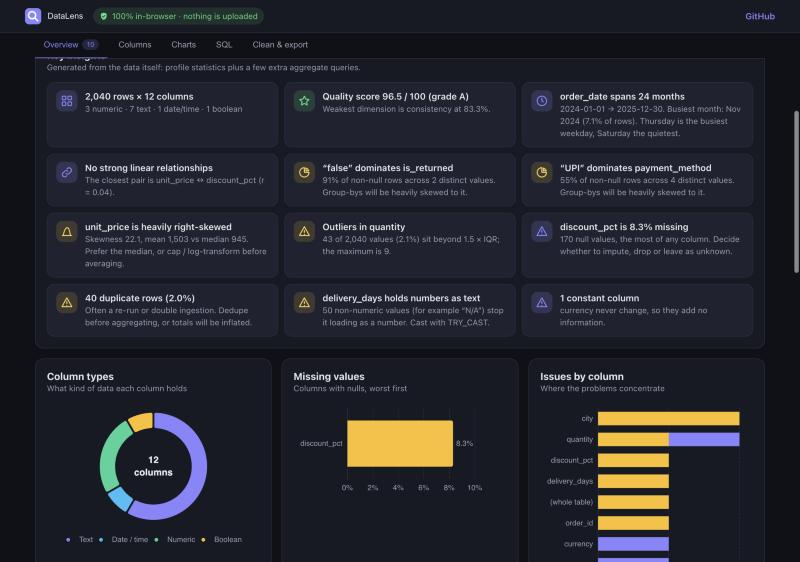
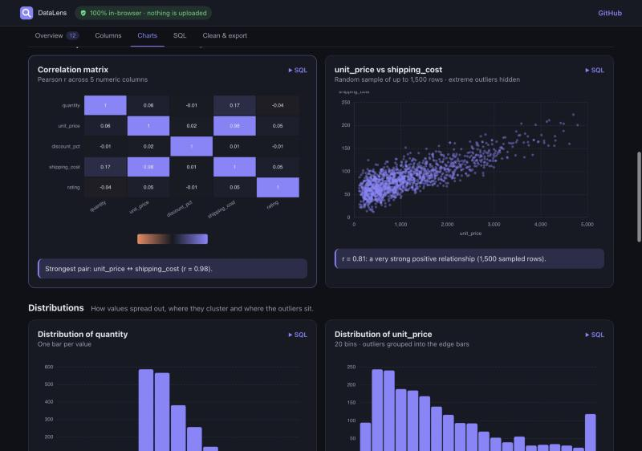
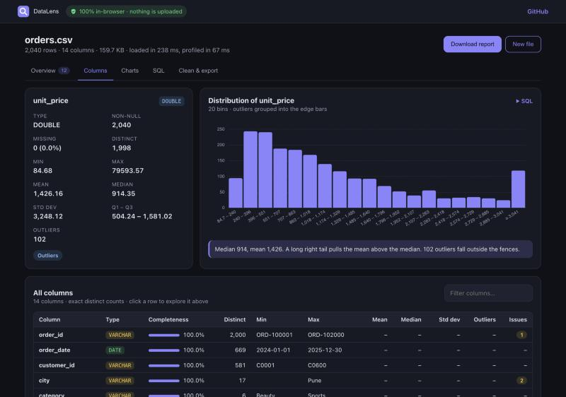
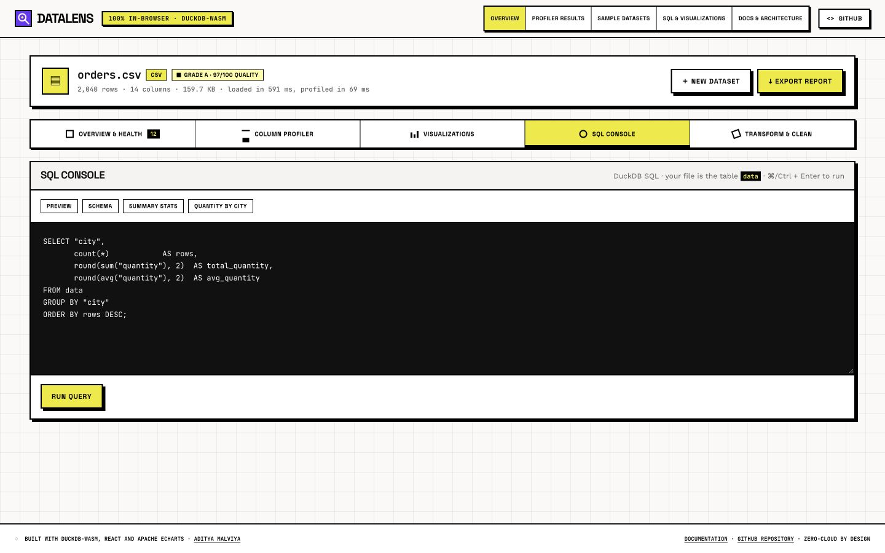
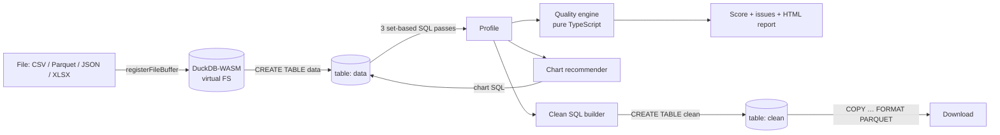

# DataLens

**Drop a dataset, get answers in seconds.** DataLens profiles any CSV, Parquet, JSON or Excel file, scores its data quality, draws the right charts, gives you a SQL console and cleans the data with one click. It all runs **inside your browser** on DuckDB compiled to WebAssembly, so your data never leaves your machine.

**[Live demo →](https://adityamalviya04692.github.io/datalens/)** · click **"Try a sample dataset"** to see it find 10 planted data quality issues.








---

## What it does

| | |
|---|---|
| **Profile** | Type, null %, exact distinct count, min/max, mean, median, std dev, quartiles and IQR outliers for every column. |
| **Score** | A 0–100 data quality score across four dimensions (completeness, validity, uniqueness, consistency) with a letter grade. |
| **Detect** | Duplicate rows, duplicate keys, missing values, untrimmed whitespace, blank strings, numbers stored as text, impossible negatives, constant columns, outliers. |
| **Insights** | Up to 12 plain-English findings computed from the data: time coverage and peak month/weekday, strongest correlation, dominant categories, skew, outliers, missing data, duplicates, unique keys, numbers stored as text, constant columns. |
| **Overview visuals** | KPI strip, a quality-dimension radar, a column-type donut, missing-values bars and issues-by-column bars. |
| **Visualise** | Up to 16 charts in four sections, chosen from column types. **Trends:** time series, stacked series by category, day-of-week and monthly seasonality. **Relationships:** correlation heatmap and a scatter plot of the strongest continuous pair. **Distributions:** outlier-aware histograms. **Categories:** top-N bars and box plots by group. Each chart has a one-line takeaway computed from its data, and shows the SQL behind it. |
| **Explore** | Click any column for its stats, issues and a tailored chart. |
| **Query** | A DuckDB SQL console over your file (`SELECT … FROM data`). |
| **Clean** | Dedupe, trim, blank → NULL, fix types, drop empty columns. Generates one reproducible SQL statement, re-profiles the result, and shows the before/after score. |
| **Export** | Cleaned data as Parquet (ZSTD) or CSV, the cleaning SQL as a `.sql` file, and a self-contained HTML quality report. |



## Architecture



Everything runs in a Web Worker in the browser tab. The site is static and hosted for free on GitHub Pages, with no backend, no database and no data upload.

## Engineering decisions

- **DuckDB-WASM over pandas/Pyodide.** A columnar, vectorised SQL engine built for analytical scans, which reads Parquet natively and runs off the main thread. The WASM bundles are self-hosted rather than loaded from a CDN, so the privacy claim holds. (The JSON and Excel readers are DuckDB extensions, fetched once from the official DuckDB extension repository. Your data is never sent anywhere.)
- **Set-based profiling.** The whole profile is three SQL passes: one wide aggregate that computes every per-column metric with positional aliases (`c{i}_{metric}`, so any column name is safe), a second pass for IQR outliers that needs the quartiles first, and a `DISTINCT` pass for duplicate rows. No row-by-row JavaScript.
- **Pure, tested scoring logic.** The quality rules, scoring, chart choice and cleaning SQL are pure functions of the profile with no DOM and no database, so they're unit-tested with Vitest and run in CI.
- **Insights as pure functions.** `buildInsights(profile, quality, extras)` turns the profile plus a handful of aggregate queries (correlations, skewness, top categories, calendar peaks) into ranked findings. The SQL lives in `insightsData.ts` and the wording in `insights.ts`, so the logic is unit-tested without a database, and a failing optional query degrades to fewer insights instead of breaking the load.
- **Charts say what they show.** Every chart gets a computed one-line takeaway (peak period, trend, busiest weekday, correlation strength). The scatter plot only uses continuous columns, samples 1,500 rows with a fixed seed, and hides extreme outliers so the cloud stays readable.
- **Explainable scoring.** Each dimension is a plain ratio (for example, completeness is the mean non-null share per column), and the weights are shown in the UI:

  | Dimension | Weight | Measures |
  |---|---|---|
  | Completeness | 30% | non-null cells |
  | Validity | 30% | values free of whitespace, blanks, non-numeric text in numeric columns, impossible negatives |
  | Uniqueness | 25% | rows that are not exact duplicates |
  | Consistency | 15% | columns with a single sensible type and more than one value |

- **Charts that survive real data.** Histograms clip to the 1.5 × IQR fences and push outliers into the edge bins, so one ₹1.6 lakh order doesn't flatten the distribution. Small integer ranges get one bar per value. ID-like and constant columns are skipped.
- **Reproducible cleaning.** Cleaning isn't hidden JavaScript. It's one readable `CREATE TABLE AS SELECT` statement you can save and run in any DuckDB, or port to Spark SQL or dbt.

## Tech stack

DuckDB-WASM · TypeScript · React 19 · Vite · Apache ECharts · Apache Arrow · Vitest · GitHub Actions · GitHub Pages

## Run locally

```bash
npm install
npm run dev          # http://localhost:5173
npm test             # unit tests
npm run build        # production build in dist/
npm run sample       # regenerate public/sample/orders.csv
```

## Deploy (free)

1. Create a public GitHub repository named `datalens` and push this code to the `main` branch.
2. In the repository, go to **Settings → Pages → Build and deployment** and set **Source** to **GitHub Actions**.
3. Every push to `main` runs typecheck → tests → build → deploy. The app is live at `https://<your-username>.github.io/datalens/`.

The build uses relative asset paths (`base: './'`), so it works under any repository name.

## Sample dataset

`public/sample/orders.csv` is **synthetic** (generated by `scripts/generate-sample.mjs` with a fixed seed): 2,040 Indian e-commerce orders with deliberately planted problems. These include 40 duplicate rows from a re-run ingestion, untrimmed and blank city names, `"N/A"` in a numeric column, negative quantities, price outliers, missing discounts and ratings, and a constant `currency` column. `shipping_cost` is generated from price and quantity, so the correlation and scatter views have a real relationship to find.

## Project structure

```
src/
  lib/
    duckdb.ts       engine bootstrap, file loading, Arrow → JS, export
    profileSql.ts   SQL builders for the profiling passes
    profile.ts      runs the profile against DuckDB
    quality.ts      checks, dimension scores, grade
    charts.ts       chart recommender, chart SQL, histogram binning
    insights.ts     plain-English findings (pure)
    insightsData.ts the extra aggregate queries that feed the insights
    takeaways.ts    one-line caption for each chart
    clean.ts        cleaning SQL builder
    report.ts       standalone HTML report
    *.test.ts       unit tests
  components/       React UI (Overview, Visuals, Columns, Charts, SQL, Clean)
scripts/generate-sample.mjs
.github/workflows/deploy.yml
```

## Roadmap

- Natural-language → SQL using a free-tier LLM API (opt-in, schema only, never rows)
- Compare two files: schema drift and distribution drift between yesterday's and today's extract
- Export the checks as a data contract (YAML) or a Great Expectations / Soda suite
- Remember recent datasets locally with OPFS

## License

MIT © Aditya Malviya
